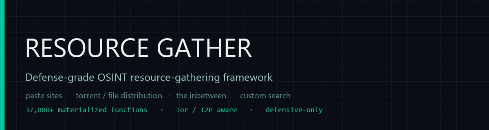
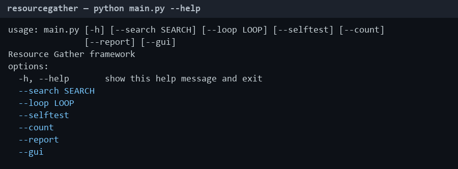
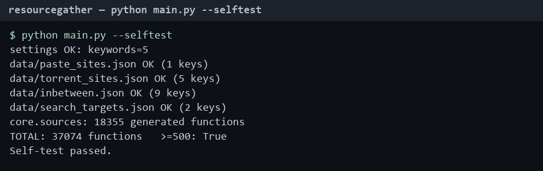

<p align="center">
  
</p>

<h1 align="center">RESOURCE GATHER</h1>

<p align="center">
  <strong>Defense-grade OSINT / threat-intel resource-gathering framework — map and
  monitor public sharing infrastructure: paste sites, torrent / file distribution,
  the "inbetween", and custom search.</strong>
</p>

<p align="center">
  <a href="LICENSE"></a>
  
  
  
  
  
</p>

---

`Resource Gather` is a ground-up, **defensive** OSINT framework for mapping and
monitoring public sharing infrastructure across four tiers:

| Tier | Inventory | What it covers |
| --- | --- | --- |
| **1** | `paste_sites.json` | 900+ public paste services (Pastebin alternatives, self-hosted bins) |
| **2** | `torrent_sites.json` | 860+ public / legal / private trackers + indexes |
| **3** | `inbetween.json` | 2,980+ forums, ransomware leak sites, dark-web + I2P search, stealer-log markets, aggregators |
| **4** | `search_targets.json` | 650+ custom-search endpoints (clear / Tor / I2P) |

The machine-readable inventories in `data/` **drive code generation**: `core.sources`
materializes **37,000+** live adapter functions — `monitor_<site>`,
`search_<site>`, `snapshot_<site>`, `validate_<site>`, `extract_<site>` — one set
per source. DRY, not stubs.

| Feature | |
| --- | --- |
| Runtime | Python 3.8+ · single-file `ResourceGather.exe` available |
| Functions | 37,000+ materialized at runtime (gate: &ge;500) |
| Ethics | `core.ethics` enforces defensive scope + PII redaction on export |
| OPSEC | Tor / I2P aware (`config/settings.json`) |
| Export | CSV / JSON / STIX / MISP, chain-of-custody storage |
| UI | CLI + optional Tkinter GUI |

---

## Screenshots

Banner                          | CLI help (`python main.py --help`)
:------------------------------:|:------------------------------:
 | 

Self-test (`python main.py --selftest`) |
:-------------------------------------:


---

## Quick start

### Option A — Standalone exe

1. Download `ResourceGather.exe` from the [latest release](https://github.com/Nortaq-PlayNexus/resourcegather/releases/latest).
2. Keep it next to `config/` and `data/` (as shipped).
3. Double-click `ResourceGather.exe`, or run with CLI flags below.

### Option B — From source

```bat
pip install -r requirements.txt
python main.py --selftest      REM verify config + data + generated functions
python main.py --gui           REM optional Tkinter UI
```

---

## Workflow

```
+-----------+     +-------------+     +-------------+     +-------------+
|  INGEST   | --> |   SEARCH    | --> |   STORAGE   | --> |   REPORT    |
| keywords/ |     | per-source  |     | chain-of-   |     | CSV/JSON/   |
| scope     |     | adapters*   |     | custody +   |     | STIX/MISP   |
+-----------+     +-------------+     | analytics   |     +-------------+
                                      +-------------+
        * core.sources generates monitor_/search_/snapshot_/validate_/extract_<site>
          for every entry in data/*.json  (37,000+ functions)
```

1. **Ingest** — `config/settings.json` defines scope, keywords, proxies, and alerts.
2. **Search** — each source gets tailored adapter functions; searches run across
   clear / Tor / I2P networks.
3. **Storage** — findings are fingerprinted and written with chain-of-custody;
   `core.ethics` redacts PII and blocks prohibited patterns before export.
4. **Report** — `python main.py --report` produces summaries and exports
   (CSV / JSON / STIX / MISP).

---

## CLI

```
python main.py --selftest                       # config + data + generated fns
python main.py                                  # one monitoring pass
python main.py --search "acme corp"             # custom crawl across all sites
python main.py --search "acme corp" --loop 1800 # AUTOMATED repeated search
python main.py --report                         # summary + export
python main.py --count                          # CI gate: prints function count
python main.py --gui                            # Tkinter search UI
```

Set `PASTEBIN_API_KEY` (Pastebin path) and `ALERT_WEBHOOK` (Telegram/Discord) via
`.env` — see [.env.example](.env.example). Never commit secrets.

---

## Directory map

```
ResourceGather/
├── main.py                # CLI + optional Tkinter GUI
├── count_functions.py     # verifies >= 500 callable functions
├── build.spec             # PyInstaller -> ResourceGather.exe
├── requirements.txt
├── pyproject.toml
├── config/
│   └── settings.json      # scope, keywords, proxy, alert, auto-search
├── data/                  # machine-readable inventories (drive code generation)
│   ├── paste_sites.json     # Tier 1
│   ├── torrent_sites.json   # Tier 2
│   ├── inbetween.json       # Tier 3 (forums, leak sites, I2P, aggregators)
│   ├── search_targets.json  # custom-search endpoints (clear/Tor/I2P)
│   └── trackers.txt         # public BitTorrent trackers
├── core/                   # package
│   ├── config_loader.py     # path resolution (PyInstaller-aware)
│   ├── tor_client.py        # Tor SOCKS session helper
│   ├── utils.py             # general helpers
│   ├── validation.py        # format / indicator validators
│   ├── opsec.py             # OPSEC primitives
│   ├── ethics.py            # policy + PII redaction
│   ├── parsers.py           # indicator extraction
│   ├── storage.py           # chain-of-custody + exports (CSV/JSON/STIX/MISP)
│   ├── analytics.py         # correlation / scoring / timeline
│   ├── scheduler.py         # timed loops
│   ├── sources.py           # *** code generator: materializes 1000s of functions ***
│   ├── search.py            # custom search + automated monitoring
│   └── report.py            # summaries / exports
├── tools/                  # data-acquisition / maintenance scripts
│   ├── expand_more.py        # expand inventories from vetted sources
│   ├── probe_sites.py        # reachability probe of every URL
│   ├── prune_dead.py         # remove dead/404 entries
│   ├── _crossdedupe.py       # remove cross-type duplicate URLs
│   └── gen_assets.py         # regenerate docs/screenshots
├── docs/
│   ├── BUILDING.md           # build from source / exe
│   ├── screenshots/          # banner + CLI images
│   ├── pastebin_sites.md     # reference notes
│   ├── the_inbetween.md
│   ├── torrent_sites.md
│   └── RESOURCE_FRAMEWORK.md
├── tests/
│   └── test_smoke.py         # self-test + function-count gate
└── output/                 # findings.csv + snapshots/ (generated at runtime)
```

---

## Building the exe

```bat
pip install pyinstaller
pyinstaller build.spec
REM -> dist/ResourceGather/ResourceGather.exe
```

Read-only assets (`config/`, `data/`) bundle via `sys._MEIPASS`; `output/` is
written beside the exe. Full guide in [docs/BUILDING.md](docs/BUILDING.md).

---

## Data inventory (verified-working)

Every URL in `data/` was probed for reachability; dead/404 entries were pruned.

| Type | Verified entries |
| --- | --- |
| paste sites (Tier 1) | 904 |
| torrent / file (Tier 2) | 862 |
| the inbetween (Tier 3) | 2,986 |
| custom search (Tier 4) | 651 |

To re-validate or expand: `python tools/expand_more.py`, then
`python tools/probe_sites.py`, `python tools/prune_dead.py`.

---

## Notes & ethics

> **Strictly defensive.** Built for breach-exposure monitoring, threat-actor
> attribution, academic study, and early-warning. It does **not** endorse copyright
> infringement, unauthorized access, or participation in criminal marketplaces.

- Several Tier-3 targets are criminal infrastructure and are included **only** so
  defenders can *monitor* them. `core.ethics` blocks prohibited patterns and
  non-defensive scopes before any network call, and redacts PII on export.
- Route activity through Tor + VPN (`use_tor`, `tor_proxy`, `i2p_proxy` in
  `config/settings.json`).
- Onion / I2P addresses require a Tor / I2P client; entries without a resolvable
  address are skipped by the generator.

See [SECURITY.md](SECURITY.md) for the full authorized-use / OPSEC policy.

---

## Contributing

Contributions are welcome. Please read [CONTRIBUTING.md](CONTRIBUTING.md) and the
[Code of Conduct](CODE_OF_CONDUCT.md) before opening a pull request.

---

## License

MIT — see [LICENSE](LICENSE).
